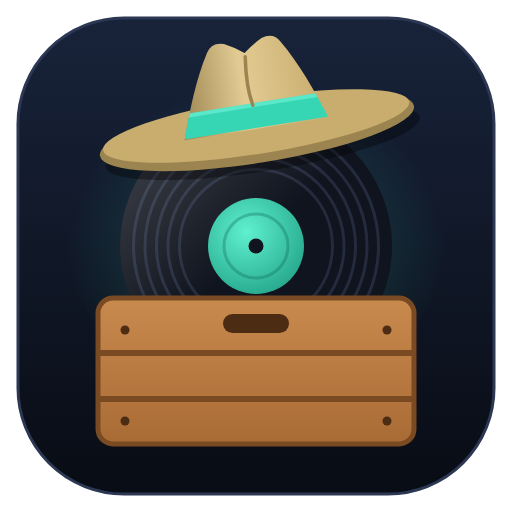
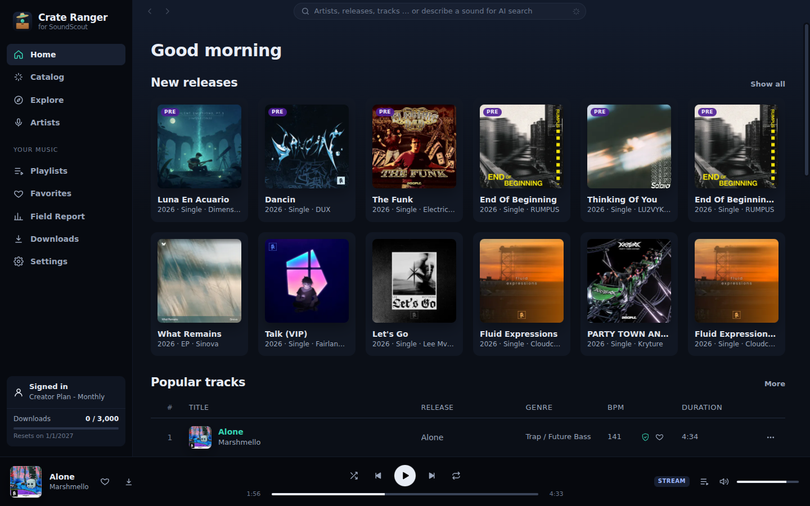
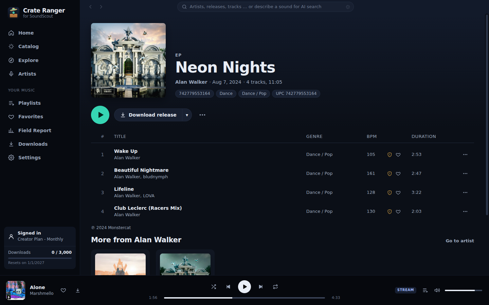
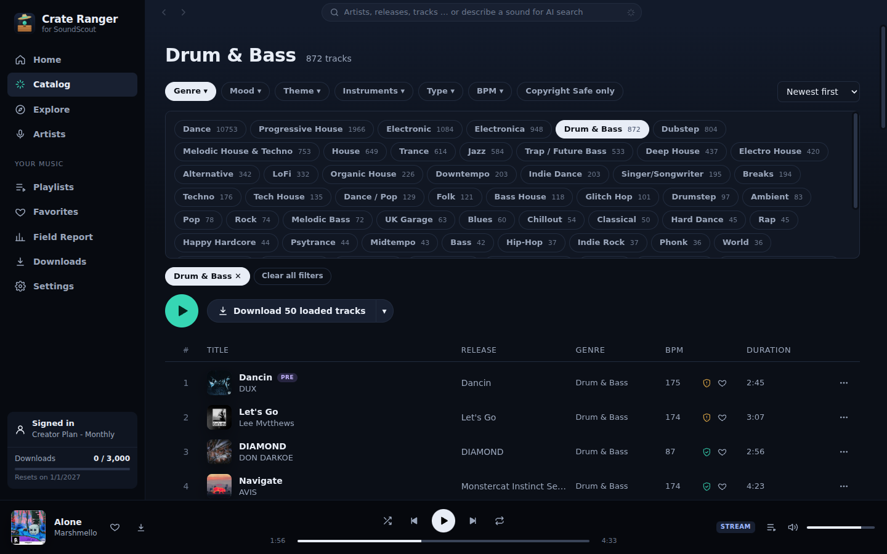
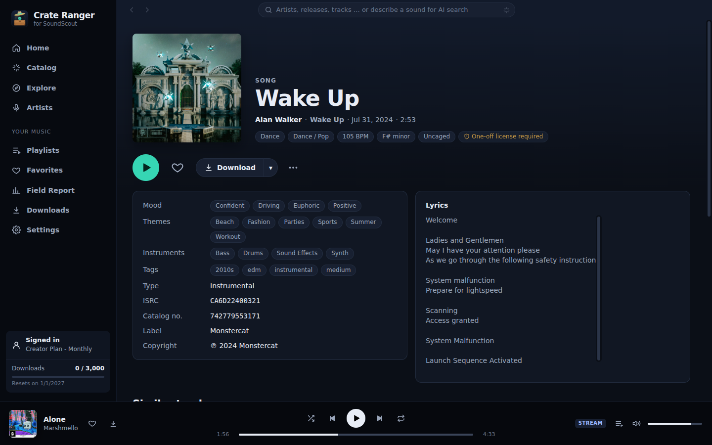
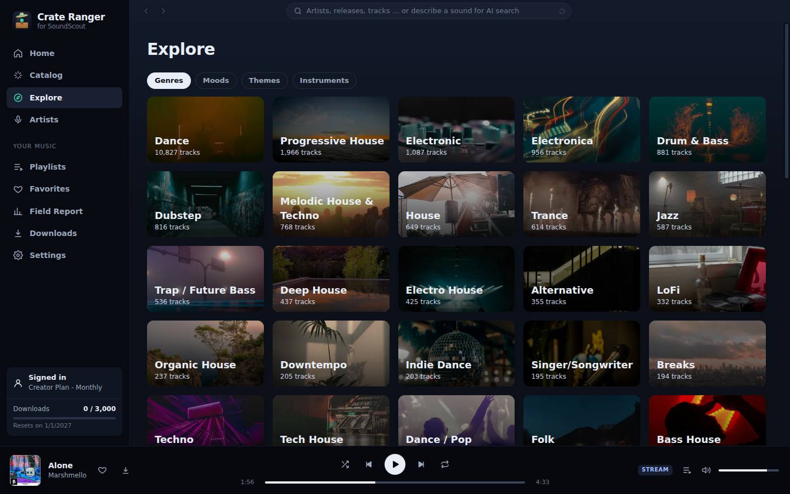
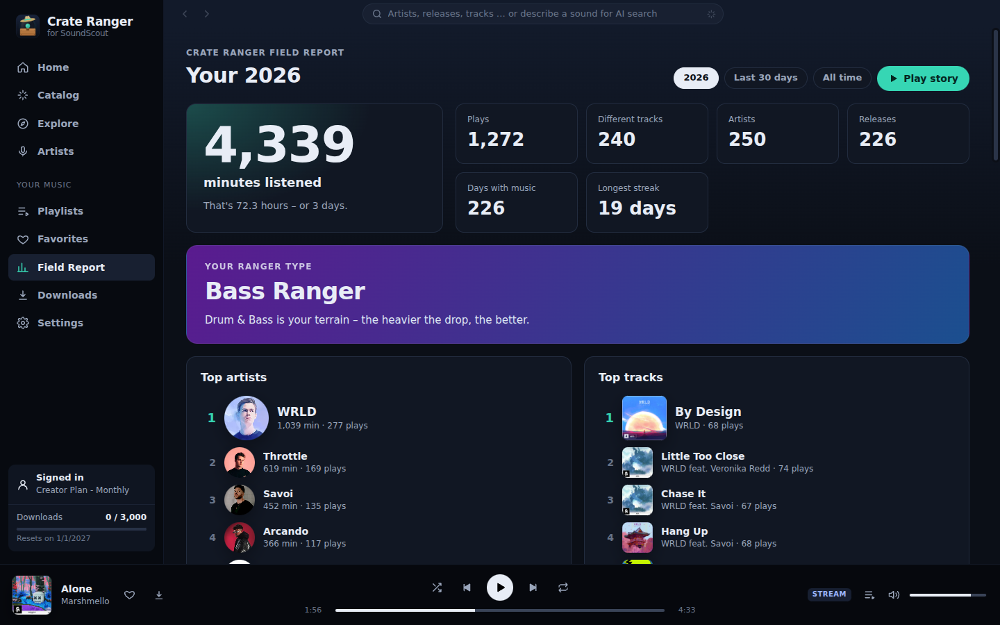
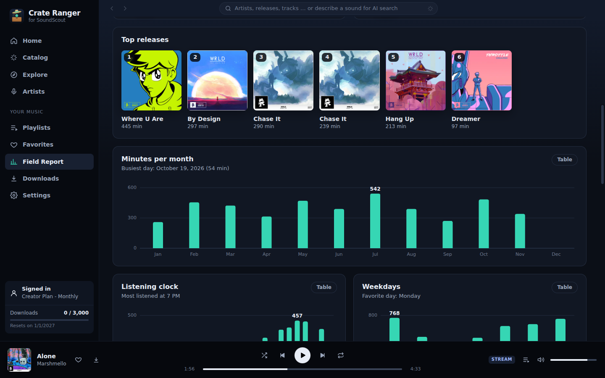
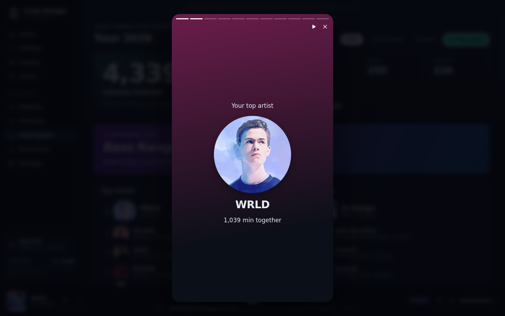
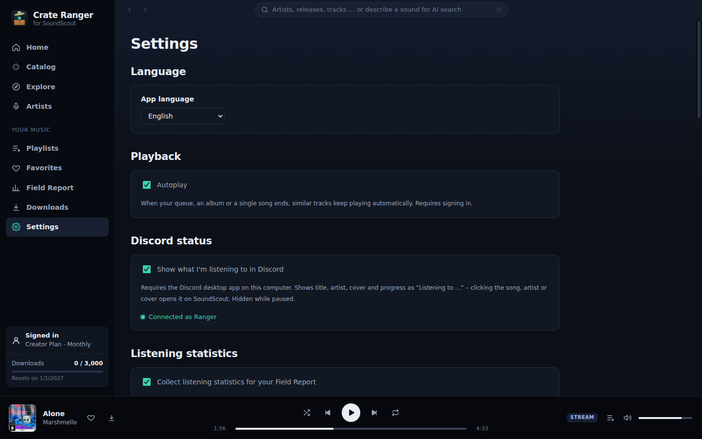

<p align="center">
  
</p>

<h1 align="center">Crate Ranger</h1>

<p align="center">
  <em>The ranger who roams the record crates.</em><br>
  An unofficial desktop music client for <a href="https://www.soundscout.com">SoundScout</a> – stream the
  Monstercat catalog, download in FLAC / MP3 / WAV with complete tags, keep track of your library and get your own Field Report.
</p>

<p align="center">
  Windows · Linux · English &amp; German · 🇩🇪 <a href="README.de.md">Deutsche Version</a>
</p>

> [!NOTE]
> Crate Ranger is not affiliated with SoundScout, Monstercat or Create Music Group.
> Downloads are only possible within your own paid SoundScout plan and count towards its quota.



## Features

### 🎧 Listen & discover
- **Browse** new releases, popular tracks, curated playlists, artists and the full catalog.
- **Filter the catalog** by genre, mood, theme, instruments, release type, BPM range and “Copyright Safe”.
- **Explore** genres, moods and themes as tiles.
- **Search** by name (artists, releases, playlists, tracks) or describe a sound for SoundScout's **AI search**
  (Enter) – right in the title bar, from every page (<kbd>Ctrl</kbd>+<kbd>K</kbd>); every track has **similar tracks**.
- **Custom title bar** in the app's look with **back / forward** (also <kbd>Alt</kbd>+<kbd>←</kbd>/<kbd>→</kbd> and the
  mouse side buttons); the window buttons stay native, so Windows Snap Layouts keep working.
- **Player** with queue, shuffle, repeat, seeking, volume and media keys – full-length streams (MP3 320) when signed in,
  downloaded tracks play from disk, even offline.
- **Pick up where you left off** – queue, track and position are remembered; after a restart, *Play* continues
  right there.
- **Autoplay** (Settings → Playback) – when the queue, an album or a single song ends, similar tracks keep playing
  (skipping other versions of songs you just heard). The first time your music ends, the app asks once.
- **Everything is a link** – song titles open the track page, artist names the artist, release titles and covers the release.
- **Hover play** on every cover starts the whole single, EP or album.
- **Favorites** – heart the current song in the player bar or any track in a list.
- **Your playlists** – create, rename (click the title) and delete them, search them, and add tracks via
  *Add to playlist* (with search; a new playlist can be created right there).
- **Right-click menus** on every track – including the one playing in the player bar – and on playlist cards:
  play next, add to queue, add to playlist, similar tracks, go to release, download and more.

| Release | Catalog with filters |
|---|---|
|  |  |
| **Track details** | **Explore** |
|  |  |

### ⬇️ Download & tag
- Download single tracks, releases, playlists, favorites or any list as **FLAC, MP3 320 or WAV**.
- **Download queue** with parallel downloads, pause/resume, automatic retries – it stops by itself when SoundScout
  reports a quota or plan limit (limits are respected, never bypassed).
- **Complete tags** in every file: title, artists, album artist, album, track x/y, release date, all genres, BPM, key,
  ISRC, UPC, catalog number, label, brand (Uncaged/Instinct/Silk), copyright, moods, themes, instruments, lyrics,
  explicit flag, Copyright Safe status, cover and SoundScout IDs. SoundScout's non-standard ID3 header is removed
  from FLAC files – the audio stays bit-identical.
- **Tidy folder layout** (customizable template) plus a `cover.jpg` per release. Featured artists stay out of the
  folder name (“Stonebank feat. EMEL” → `Stonebank/`) so all of an artist's releases sit together; the album-artist tag
  keeps the full name:
  ```
  <download folder>/
  └─ Shingo Nakamura/
     └─ 2022 - Focus [MCS1380]/
        ├─ 01 - Focus.flac
        ├─ 02 - Focus (Extended Mix).flac
        └─ cover.jpg
  ```
- **Update tags & folders** rewrites the tags of all downloads and moves them into the current folder layout –
  no re-download, so it doesn't touch your quota.
- **Library** – remembers every download (✓ in all lists, x/y progress per release), detects moved or deleted files,
  re-imports existing downloads via “Scan folder” and offers “Download missing”.
- **Download quota meter** – “x / 3,000” for the current billing period with reset date and a warning when the queue
  would exceed what's left. SoundScout has no counter, so the app counts its own downloads.
- **Pre-releases** are marked and can't be downloaded before release day; they are skipped when queueing.

### 📊 Field Report – your listening stats
Crate Ranger keeps **local** listening statistics and turns them into your own **Field Report** – for a year, the last 30 days
or all time: minutes listened, top artists, tracks and releases, genres, moods, Monstercat labels, listening clock,
weekdays, monthly timeline, longest streak, discoveries, tempo (BPM), music eras, listening habits and your
**ranger type** (Night Owl, Bass Ranger, Trailblazer, Crate Digger, …). **Play story** shows it all as full-screen slides.

Only actually heard time counts (no seeking or pauses), a “play” counts from 30 seconds. All data stays on your computer;
collecting can be turned off and the data deleted in the settings.

| Field Report | Charts |
|---|---|
|  |  |

<p align="center"></p>

### 💬 Discord status
Show what you're listening to in Discord – “Listening to …” with title, artist, cover, progress bar and a
“Listen on SoundScout” button, hidden while paused. Clicking the **song**, the **artist** or the **cover** in Discord
opens the track, artist or release page on SoundScout. One switch in the settings; requires the Discord desktop app on
the same computer (Windows named pipe, Linux socket incl. Flatpak/Snap).

### 🌍 Languages
English and German, following your system language or a fixed choice. Adding a language is just adding a JSON file
(see [Adding a language](#adding-a-language)).



## Download

Get the latest version from the **Releases** page of this repository:

| System | File |
|---|---|
| Windows | `CrateRanger-<version>-setup.exe` (installer) or `CrateRanger-<version>-portable.exe` |
| Linux (any distribution) | `CrateRanger-<version>-x86_64.AppImage` – `chmod +x` and run |
| Debian / Ubuntu | `crate-ranger_<version>_amd64.deb` – `sudo apt install ./crate-ranger_<version>_amd64.deb` |

The Windows builds are not code-signed, so SmartScreen asks on first start (“More info” → “Run anyway”).

**Update check:** on first start the app asks whether it may look for new versions. If you agree, it fetches the
public release list of this repository from the GitHub API at most every 6 hours (no account or usage data; GitHub
sees your IP address as with any request) and points you to the new release – downloading stays up to you.
It can be switched off in *Settings → Updates*. Forks: set `UPDATE_REPO` in `src/shared/update.ts`.

## Signing in

**Sign in** opens the official SoundScout sign-in page in an app window (captcha and 2FA work as usual). The app never
stores your password, only the session (valid for 30 days). If the captcha check fails there, the dialog offers
**“Sign in with a browser session”**: sign in with your normal browser and paste the value of the `goldloginz` cookie.

Without signing in you can browse the catalog and listen to 30-second previews; full streams, search, playlists,
favorites and downloads need an account (downloads a paid plan).

## Adding a language

1. Copy `src/shared/locales/en.json` to e.g. `src/shared/locales/fr.json`.
2. Set `meta.name` (“Français”) and `meta.englishName` (“French”) and translate the values. Keep placeholders like
   `{{count}}` and markup like `<b>…</b>`; plural forms use CLDR suffixes (`_one`, `_other`, `_few`, …).
3. Run `npm test` – it checks that every key, placeholder and tag is present.

The file is picked up automatically and appears in the language selector; no code changes needed
([i18next](https://www.i18next.com) with type-safe keys, `en.json` is the reference).

## Development

```bash
npm install
npm run dev                  # start with hot reload
npm test                     # unit tests (vitest)
npm run typecheck
npm run dist:win             # dist/CrateRanger-<version>-portable.exe (also builds on WSL/Linux)
npm run dist:win:installer   # NSIS installer – run on Windows (Linux needs wine)
npm run dist:linux           # AppImage + .deb (.deb needs a homepage, e.g. -c.extraMetadata.homepage=…)
```

- `SS_TEST_FLAC=/path/to/file.flac npm test` also runs the tagger tests against a real SoundScout FLAC.
- `CRATE_RANGER_USER_DATA=/some/dir` starts the app with a separate data folder (e.g. demo statistics) without touching
  your real settings, library or stats.
- `scripts/smoke.mjs` and `scripts/e2e-loggedin.mjs` drive the built app (`npm run build`) and take screenshots;
  `e2e-loggedin.mjs` downloads exactly one track only with `E2E_DOWNLOAD=1`.
- `scripts/readme-screenshots.mjs` regenerates the screenshots in `docs/screenshots/` from a demo data folder and
  replaces private details (plan name, local paths, Discord user).

> **WSL:** VS Code sets `ELECTRON_RUN_AS_NODE`; the scripts remove it, for a manual start use
> `env -u ELECTRON_RUN_AS_NODE npx electron-vite dev`. Don't start the Windows `.exe` from `\\wsl.localhost\…`
> (the GPU process fails) – copy it to Windows first.

### Releasing

Pushing a version tag builds and publishes a GitHub release automatically (`.github/workflows/release.yml`):

```bash
git tag v0.2.0
git push origin v0.2.0
```

Typecheck & tests → builds on Windows (installer + portable) and Linux (AppImage + .deb) → GitHub release with all
files, `SHA256SUMS.txt` and generated release notes. The version is taken from the tag; tags with a hyphen
(`v0.3.0-beta.1`) become pre-releases. *Actions → Release → Run workflow* builds without publishing. Actions are pinned
to commit SHAs and kept up to date by Dependabot.

### Architecture

```
src/main/          Electron main process (all network access)
  api/             SoundScout API client (session cookie, column lists)
  auth.ts          sign-in window, session import, sign-out
  stream.ts        resolves signed stream URLs
  downloads/       metadata → path → download → tags → cover.jpg → library; queue & quota
  library/         JSON index and folder scan
  discord/         Discord Rich Presence (IPC protocol, connection, activity)
  stats/           local listening statistics (JSON lines) for the Field Report
  mediaProtocol.ts media:// for local playback (with range requests)
src/preload/       narrow IPC bridge (window.ss)
src/renderer/      React UI (router, TanStack Query, Zustand)
src/shared/        shared types, locales, Field Report computation
```

The SoundScout website API (`https://www.soundscout.com/api`) is unofficial. All endpoints are encapsulated in
`src/main/api` and `src/renderer/src/lib/api.ts`; the renderer may only call whitelisted paths (`src/main/ipc.ts`).
